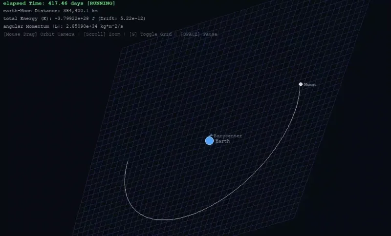

# Gravity

An interactive Python/Pygame Newtonian gravity simulation of an idealized Earth–Moon system. The project initializes circular orbits around a shared barycenter, advances bodies with velocity Verlet integration, and displays a perspective view of a gravitational potential mesh alongside live physical diagnostics.



## Current scope

Implemented:

- Three-dimensional body state using NumPy `float64` vectors.
- Earth–Moon initial conditions in the X–Z plane, with the barycenter at the origin.
- Pairwise Newtonian gravitational acceleration for a list of bodies.
- Velocity Verlet integration, with 50 physics substeps per rendered frame.
- Kinetic, gravitational potential, and total energy diagnostics.
- Angular momentum diagnostics.
- Interactive perspective camera with mouse orbit, zoom, and view reset.
- Softened gravitational potential wireframe, labeled bodies, barycenter marker, and orbital trails.
- Live HUD showing elapsed simulated time, separation, total energy, relative energy drift, and angular momentum magnitude.
- Pause/resume and potential-grid toggle.
- Tests for initial conditions and conservation over approximately one orbit.

The simulation runs interactively through `main.py` or headlessly through the Python API and tests.

## Setup

Python 3.11 is the currently verified environment. Run these commands from the project root (`Gravity/`).

### Windows PowerShell

```powershell
python -m venv .venv
.\.venv\Scripts\Activate.ps1
python -m pip install -r requirements.txt
```

Dependencies:

- **NumPy** — vectors and numerical calculations.
- **pytest** — automated tests.
- **Pygame** — window, rendering, and input handling.

## Run the interactive simulation

With the virtual environment active, run from the project root:

```powershell
python main.py
```

The application opens a 1200 × 800 window. At the default time warp, one real second advances 2.5 simulated days while running.

### Controls

| Input | Action |
|---|---|
| Left mouse drag | Orbit the camera |
| Mouse wheel | Zoom in or out |
| `Space` | Pause or resume physics |
| `G` | Toggle the potential grid and body height displacement |
| `R` | Reset camera angles and zoom, not the simulation |
| `Esc` or close window | Quit |

### Understanding the visualization

The wireframe is a height map of softened Newtonian gravitational potential, not a general-relativistic spacetime simulation. More negative potential creates a deeper funnel. With the grid enabled, bodies are displayed at their local potential height, including their own softened contribution. Disabling it returns the body markers to the flat orbital plane without changing the physics.

Orbital trails and the barycenter marker remain at visual `y = 0`, so they do not line up vertically with displaced bodies. Earth's barycentric orbital radius is only about 0.46 visual units; its trail can be hidden by its 12-pixel marker. Body marker sizes are visibility overrides, not physical radii to scale.

Visual settings live in `config/constants.py`:

| Setting | Current value | Purpose |
|---|---|---|
| `SIM_SCALE` | `38.0 / R_EARTH_MOON` | Maps Earth–Moon separation to 38 visual units |
| `POTENTIAL_VISUAL_SCALE` | `8.5e-7` | Converts potential into visual height |
| `SOFTENING_SIM` | `1.8` | Smooths potential funnel centers in visual units |
| `GRID_EXTENT` | `55.0` | Grid half-width |
| `GRID_STEPS` | `44` | Samples along each grid axis |
| `TIME_WARP` | `86400 * 2.5` | Simulated seconds per real second |
| `PHYSICS_SUBSTEPS` | `50` | Integration steps per frame |

The current potential scale and softening place Earth's initial marker at approximately `y = -18.62`, visible with the default camera. These two settings affect visualization only, not orbital forces. Excessively deep funnels can move markers off-screen or behind the camera's near plane. Try `R` to restore the view or `G` to inspect the flat orbits.

## Run the tests

With the virtual environment active, run from the project root:

```powershell
python -m pytest tests/
```

To run only the conservation tests:

```powershell
python -m pytest tests/test_conservation.py
```

Use `python -m pytest` from the project root so Python can resolve local modules such as `simulation` and `physics`. Running from inside `tests/` can cause `ModuleNotFoundError`.

The five tests cover:

- The barycenter lying inside Earth.
- An initial orbital period between 27.2 and 27.5 days.
- Near-zero initial total linear momentum, using a scale-aware floating-point tolerance.
- The circular-orbit energy relationship: `K = -U / 2`.
- Final energy and angular momentum relative to their initial values after approximately one orbit, using a 60-second timestep.

The conservation test compares the beginning and end of the run; it does not measure the maximum error throughout the orbit.

## Run a headless simulation

From the project root, start `python` and run:

```python
from simulation.orbital_setup import create_earth_moon_system
from physics.integrators.verlet import compute_acceleration, step_velocity_verlet
from physics.diagnostics import compute_total_energy

earth, moon, stats = create_earth_moon_system()
bodies = [earth, moon]

# Initialize acceleration before taking the first Verlet step.
for body, acceleration in zip(bodies, compute_acceleration(bodies)):
    body.acceleration = acceleration

_, _, initial_energy = compute_total_energy(bodies)

dt = 60.0  # Simulated seconds per step.
steps = int(stats["period_days"] * 86400.0 / dt)
for _ in range(steps):
    step_velocity_verlet(bodies, dt)

_, _, final_energy = compute_total_energy(bodies)
print("Earth position (m):", earth.position)
print("Moon position (m):", moon.position)
print("Relative energy error:", abs(final_energy - initial_energy) / abs(initial_energy))
```

`step_velocity_verlet` updates bodies in place. It requires valid accelerations at the current positions before the first step; newly created bodies initially have zero acceleration. Subsequent steps update acceleration automatically.

## Project layout

```text
Gravity/
├── assets/
│   └── simulation_preview.webp # Recording of the interactive view
├── config/
│   └── constants.py          # Physical, display, and time-warp settings
├── simulation/
│   ├── body.py               # Body state and trail storage
│   └── orbital_setup.py      # Earth–Moon circular-orbit initialization
├── physics/
│   ├── diagnostics.py        # Energy and angular momentum
│   └── integrators/
│       └── verlet.py         # Pairwise acceleration and velocity Verlet
├── tests/
│   ├── test_setup.py         # Initial-condition checks
│   └── test_conservation.py  # Energy and angular-momentum checks
├── field/
│   └── potential_grid.py     # Softened potential height field
├── input/
│   └── controls.py           # Camera and simulation input
├── visualization/
│   ├── camera.py             # Perspective projection and camera state
│   └── renderer.py           # Wireframe, bodies, trails, and HUD
├── main.py                   # Interactive application loop
└── requirements.txt
```

## Model and limitations

- Physics uses SI units: meters, kilograms, and seconds. Setup statistics explicitly labeled `_km` or `_days` are converted for reporting.
- Initial Earth–Moon motion is circular and isolated, not an ephemeris-based model of the real system. Solar perturbations and other external forces are not included.
- Gravity treats bodies as point masses. Stored radii do not provide collision detection or contact physics.
- Pairwise acceleration has O(N²) computational cost and no gravitational softening. Coincident positions are skipped rather than resolved as collisions; close encounters require particular care with timestep choice.
- The interactive loop divides each frame's elapsed time, multiplied by `TIME_WARP`, into `PHYSICS_SUBSTEPS` equal steps. The timestep therefore varies between frames; long stalls can reduce accuracy. The headless example and conservation test use a fixed 60-second step. There is no error-based adaptive timestep control.
- `FPS` is defined but is not currently passed to `clock.tick()`, so the application does not enforce that frame-rate limit.
- Conservation accuracy depends on the system, timestep, and duration. The current tests validate the physics, not rendering or input behavior.
- Calculations use floating-point arithmetic, so conserved quantities should be checked with appropriate tolerances rather than exact equality.

## Next steps

- Add bounded or fixed-step interactive time handling for consistent behavior across frame rates and stalls.
- Improve visual alignment between orbital trails, body markers, and the potential mesh.
- Extend validation to longer runs, intermediate conservation errors, additional orbital configurations, and visualization behavior.
